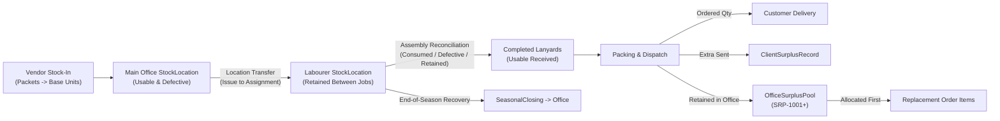

# High-Level Design (HLD) — Pro Office (Phase 5 Verified)

## 1. Architectural Pattern: Modular Monolith

Pro Office is architected as a **Modular Monolith**:
- **One React 19 Single-Page Application (SPA)** serving internal office staff and administrators.
- **One Django 5 + Django REST Framework (DRF) Backend** exposing a versioned REST API under `/api/v1/`.
- **One PostgreSQL 17 Relational Database** acting as the single source of truth for all modules.
- **One Nginx Reverse Proxy** providing same-origin routing in production deployments.

### Implemented Domain Modules (Phases 1–5 Verified)
- `apps.common`: Base UUID/Timestamp models, archival mixin, standard pagination, error envelope, and health endpoint.
- `apps.accounts`: Internal user accounts (`owner_admin`, `office_worker`), role capability matrix, session & CSRF auth, and login rate limiting (labourers strictly excluded from authentication).
- `apps.audit_logs`: Immutable security and operational audit trail (`audit_logs.view` enforced).
- `apps.catalog`: Configurable specification catalog (`card_type`, `lanyard_size` capacities `12 mm = 37`, `16 mm = 30`, `20 mm = 25`, `holder`, `hook`, `accessory`).
- `apps.clients`: Duplicate-safe client directory and client order/quantity aggregation profile.
- `apps.orders`: Concurrency-safe order numbering (`ORD-1001+`), multi-item original orders, inline client creation, linked replacement orders (with optional Office Surplus allocation), and lifecycle status history.
- `apps.production`: Independent item-level production jobs (`1:1` per `OrderItem`), design lifecycle, lanyard batch calculator, partial/multiple printing runs, printing waste tracking, and stage progression.
- `apps.labour`: Office-managed labourer profiles, active/inactive tracking, and end-of-season recovery (`SeasonalClosing`).
- `apps.machines`: Physical equipment assets (`Machine`), size compatibility, allocation history (`MachineAllocation`), and single-active-holder enforcement.
- `apps.inventory`: Immutable `StockMovement` ledger, configurable vendor packagings (`MaterialPackaging`), location-separated `StockLocation` (`MAIN_OFFICE` vs `LABOURER`), usable vs. defective `InventoryBalance`, office consumption reconciliation formula, and `DefectiveRecord`.
- `apps.assembly`: Split assembly assignments across multiple labourers or `office_assembly`, balance-aware material issuance, partial receiving, and labourer material balance reconciliation.
- `apps.stock_audit`: Draft/Submit/Approve physical stock verification with mandatory variance explanations and `audit_adjustment` ledger posting.
- `apps.dispatch`: Partial/full packing & dispatch, `ClientSurplusRecord`, `OfficeSurplusPool`, and replacement order surplus reuse.

---

## 2. End-to-End Material, Production & Surplus Flow Diagram

