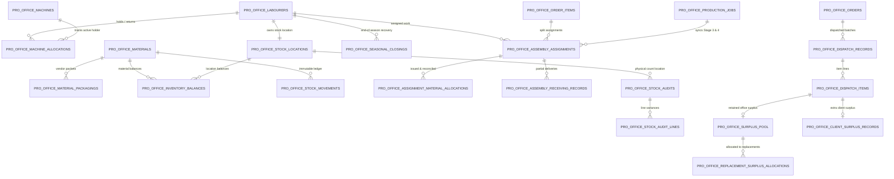

# Database Schema & Design Principles — Pro Office (Phase 5 Verified)

## 1. Implemented Database Tables (Phases 1–5)

- **Accounts (`apps.accounts`):** `pro_office_users`, `pro_office_role_permissions`
- **Audit Logs (`apps.audit_logs`):** `pro_office_audit_logs`
- **Catalog (`apps.catalog`):** `pro_office_catalog_options`
- **Clients (`apps.clients`):** `pro_office_clients`
- **Orders (`apps.orders`):** `pro_office_order_sequences`, `pro_office_orders`, `pro_office_order_items` (extended with `allocated_from_surplus_quantity`), `pro_office_order_items_accessories`, `pro_office_order_status_history`
- **Production (`apps.production`):** `pro_office_production_jobs`, `pro_office_printing_runs`, `pro_office_production_status_history`
- **Labour & Seasonal Closings (`apps.labour`):** `pro_office_labourers`, `pro_office_seasonal_closings`, `pro_office_seasonal_closing_materials`, `pro_office_seasonal_closing_machines`
- **Physical Machines (`apps.machines`):** `pro_office_machines`, `pro_office_machine_allocations`
- **Inventory & Ledger (`apps.inventory`):** `pro_office_materials`, `pro_office_material_packagings`, `pro_office_stock_locations`, `pro_office_inventory_balances`, `pro_office_stock_movement_sequences`, `pro_office_stock_movements`, `pro_office_defective_records`
- **Assembly & Material Allocations (`apps.assembly`):** `pro_office_assembly_assignments`, `pro_office_assignment_material_allocations`, `pro_office_assembly_receiving_records`
- **Physical Stock Audits (`apps.stock_audit`):** `pro_office_stock_audits`, `pro_office_stock_audit_lines`
- **Packing, Dispatch & Surplus (`apps.dispatch`):** `pro_office_dispatch_records`, `pro_office_dispatch_items`, `pro_office_surplus_pool`, `pro_office_client_surplus_records`, `pro_office_replacement_surplus_allocations`

---

## 2. Phase 4 Entity Relationship Diagram (ERD)

---

## 3. Database Integrity, Concurrency & Check Constraints (Phases 4–5)

1. **Zero Labourer Logins & Normalized Duplicate Protection:** `pro_office_labourers` has no relation to `pro_office_users` and enforces `uq_labourer_normalized_name` + `ck_labourer_normalized_name_non_empty`.
2. **Double-Allocation Prevention (`pro_office_machine_allocations` & `pro_office_machines`):** Partial unique constraint `uq_machine_single_active_allocation` guarantees at most one `is_active = True` allocation per machine, paired with `ck_machine_status_holder_consistency`.
3. **Non-Negative Stock Balances & Consistent Ledger Deltas (`pro_office_inventory_balances`):** Check constraints `ck_inventory_balance_usable_non_negative` and `ck_inventory_balance_defective_non_negative` plus `uq_inventory_balance_material_location`.
4. **Office vs. Labour Assignment Mode Consistency (`pro_office_assembly_assignments`):** Check constraint `ck_assembly_assignment_mode_labourer_consistency` guarantees `labourer` is non-null iff `assignment_mode = 'labourer'`.
5. **Non-Negative Surplus Pool (`pro_office_surplus_pool`):** `ck_office_surplus_remaining_non_neg` prevents over-allocating retained office surplus to replacement orders.
6. **Atomic Document Sequence Generation & Dispatch Idempotency (Phase 5):** `pro_office_stock_movement_sequences` serves as a shared row-locked (`SELECT ... FOR UPDATE`) counter backing `MOV-`, `DSP-`, `SRP-`, `AUD-`, and `SCL-` codes; `pro_office_dispatch_records.idempotency_key` (`unique=True, null=True`) guarantees exactly-once dispatch submission.
